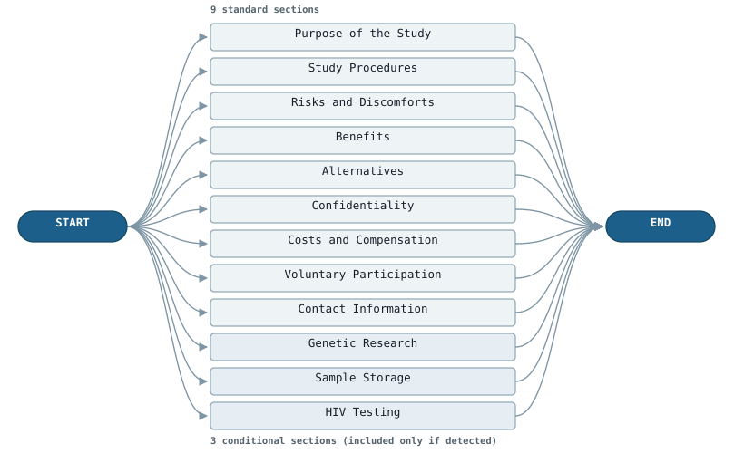
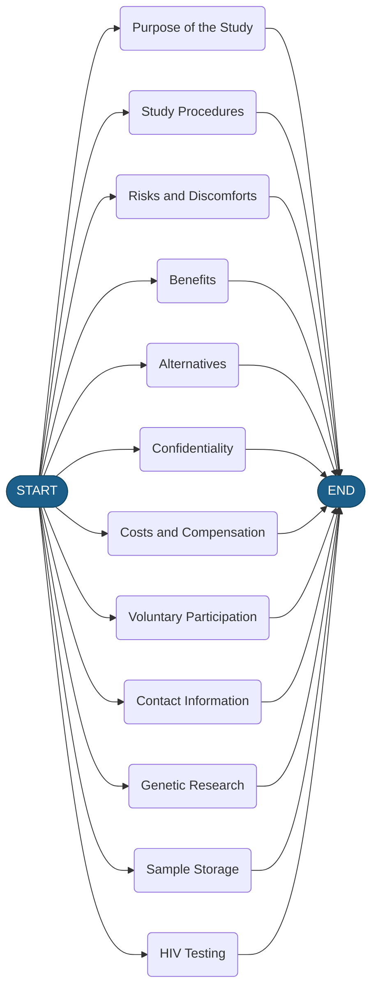
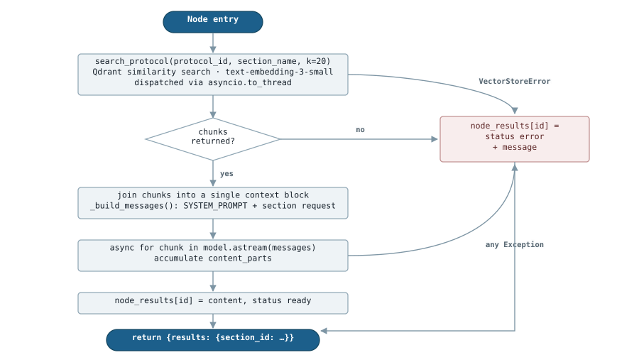
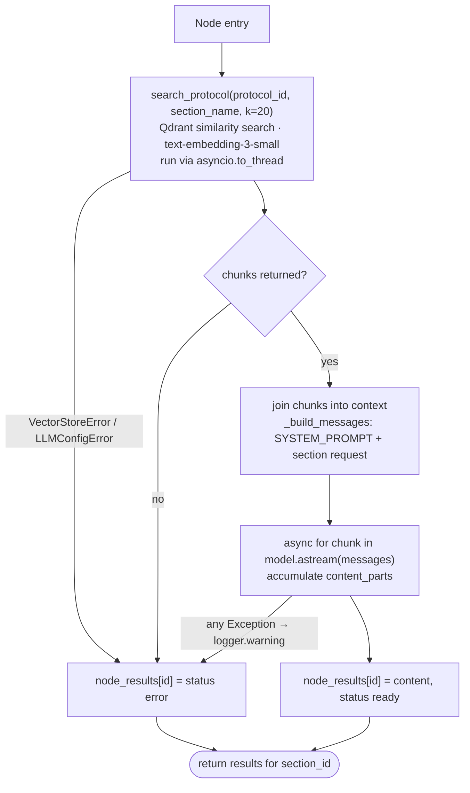
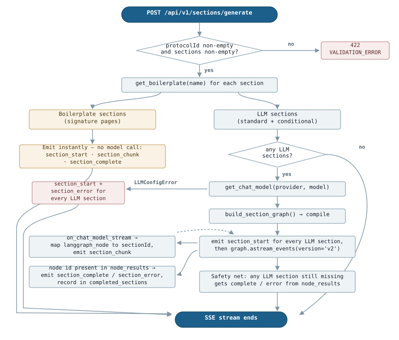
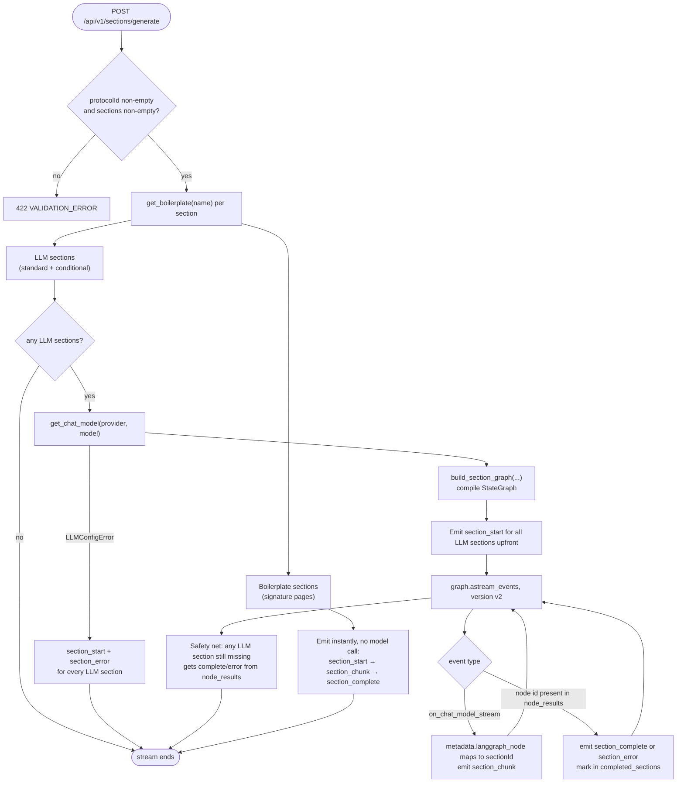
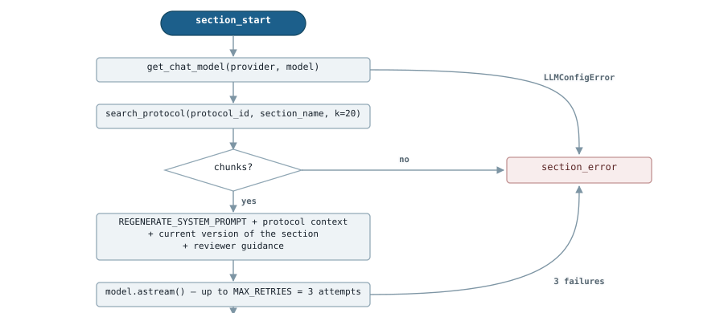
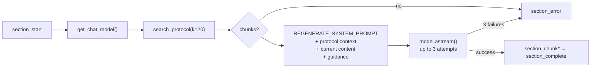

# LangGraph: ICF Section Generation

How `POST /api/v1/sections/generate` executes. Source: `backend/src/services/section_graph.py`.

The short version: the graph is a **single-layer fan-out/fan-in** — `START` → one node per
selected LLM section → `END`. There are no conditional edges, no cycles, and no shared
sequencing between sections. All the interesting work lives *inside* each node (RAG retrieval
+ token streaming) and *around* the graph (boilerplate short-circuit + SSE translation).

---

## 1. The compiled graph

Built by `build_section_graph()` (`section_graph.py:250`). One node per section, named after
the section itself, wired `START → node → END`. LangGraph runs all of them concurrently.



<details>
<summary>Mermaid source (for notebooks / GitHub rendering)</summary>



</details>

Node set is **dynamic** — it is whatever LLM-backed sections the user checked for that run.
The 12 above are the maximum (9 standard + 3 conditional). Signature sections never become
nodes; see §3.

State is a single reducer-merged dict:

```python
class SectionGraphState(TypedDict):
    results: Annotated[dict[str, SectionResult], _merge_dicts]
```

The `_merge_dicts` reducer is what makes the fan-in safe: every node returns
`{"results": {section_id: ...}}` and LangGraph merges the concurrent writes instead of
raising `InvalidUpdateError`.

### Reproducing this diagram

Same call you'd make in a notebook:

```python
from src.services.section_graph import build_section_graph

graph = build_section_graph("proto-123", llm_sections, model=None, node_results={})
print(graph.get_graph().draw_mermaid())
# in a notebook:  display(Image(graph.get_graph().draw_mermaid_png()))
```

Verbatim output (LangGraph escapes spaces in node ids as `\20`):

```
graph TD;
	__start__([<p>__start__</p>]):::first
	Purpose\20of\20the\20Study(Purpose of the Study)
	Study\20Procedures(Study Procedures)
	...
	__end__([<p>__end__</p>]):::last
	__start__ --> Alternatives;
	__start__ --> Benefits;
	...
	Alternatives --> __end__;
	Benefits --> __end__;
	...
```

---

## 2. Inside one section node

Every node is a closure produced by `_make_section_node()` (`section_graph.py:200`). This is
where RAG and the LLM call happen — LangGraph itself sees only an opaque async function.



<details>
<summary>Mermaid source (for notebooks / GitHub rendering)</summary>



</details>

Two things worth noting:

- **`node_results` is a side-channel.** The node writes into a plain dict captured by the
  closure *as well as* returning graph state. The streaming loop in §3 reads that dict to
  detect completion, because `astream_events` surfaces node events before the merged state
  is observable.
- **No retries here.** `MAX_RETRIES = 3` applies only to the regenerate path (§4). A failed
  section in the generate path fails once and reports `status: "error"`.

---

## 3. The full request pipeline

`stream_sections_parallel()` (`section_graph.py:263`) wraps the graph. The graph is only one
stage of it.



<details>
<summary>Mermaid source (for notebooks / GitHub rendering)</summary>



</details>

Boilerplate sections are emitted **before** the graph is built, so the client sees signature
pages fill in immediately while the model-backed sections are still streaming.

Which sections are which (`section_definitions.py`):

| Category | Sections | Path |
| --- | --- | --- |
| Standard | Purpose of the Study, Study Procedures, Risks and Discomforts, Benefits, Alternatives, Confidentiality, Costs and Compensation, Voluntary Participation, Contact Information | Graph node (RAG + LLM) |
| Conditional | Genetic Research, Sample Storage, HIV Testing | Graph node (RAG + LLM) |
| Signature | Adult Consent, Teen Assent, Parent/Guardian Permission | Boilerplate, emitted instantly |

A section is boilerplate iff its `SectionDef` carries `boilerplate_text`. Today that is
exactly the three signature sections.

---

## 4. Regeneration is *not* a graph

`POST /api/v1/sections/regenerate` → `stream_section_regenerate()` is a plain linear async
generator, no `StateGraph` involved. It handles one section, adds the current content plus
reviewer guidance to the prompt, and retries up to `MAX_RETRIES = 3` on transient failures.
Boilerplate sections are rejected with 422 before reaching it.



<details>
<summary>Mermaid source (for notebooks / GitHub rendering)</summary>



</details>

---

## SSE event contract

Emitted by `_sse_event()` for both endpoints:

| Event | Payload |
| --- | --- |
| `section_start` | `{sectionId, name}` |
| `section_chunk` | `{sectionId, content}` |
| `section_complete` | `{sectionId, status: "ready"}` |
| `section_error` | `{sectionId, status: "error", message}` |
